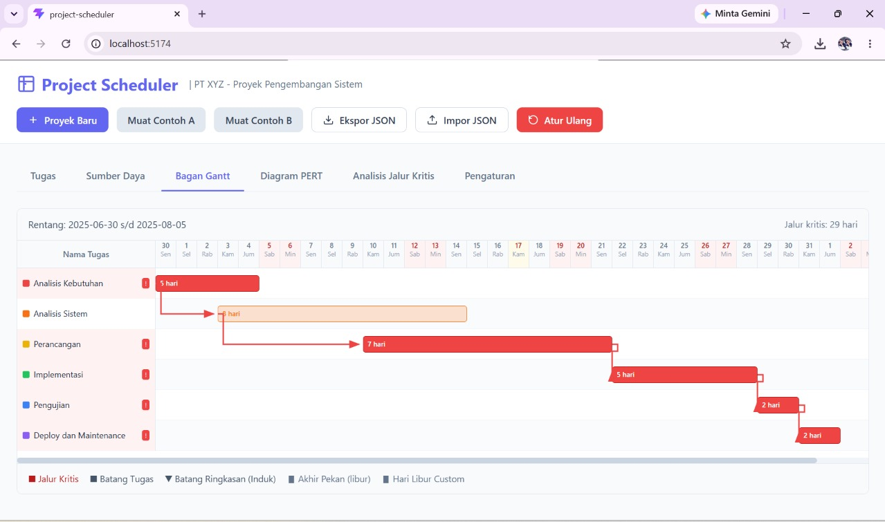
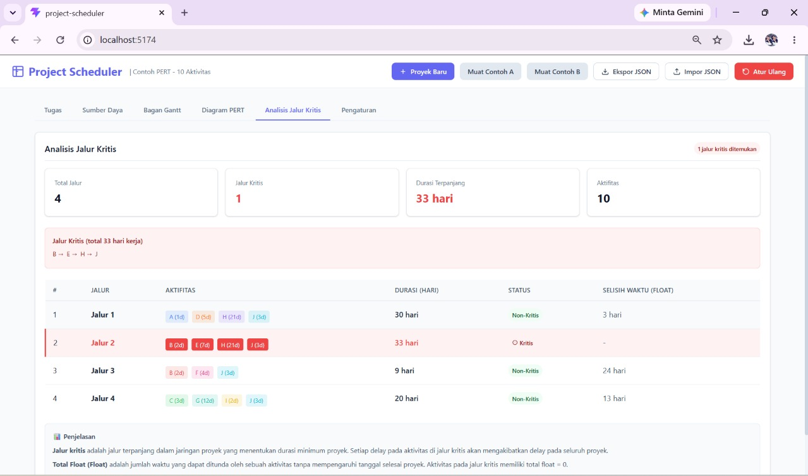

# Project Scheduler

Aplikasi web untuk perencanaan proyek dengan Gantt chart, diagram PERT, dan analisis jalur kritis. Dibangun dengan React + Vite + TypeScript tanpa backend (data disimpan di localStorage dengan fitur export/import JSON).

## Fitur

### 1. Manajemen Proyek
- Nama proyek, organisasi, website, deskripsi
- Pengaturan weekend (libur atau tetap kerja)
- Hari libur custom (one-off dan recurring)

### 2. Manajemen Tugas
- CRUD lengkap: nama, tanggal mulai, durasi (hari kerja), prioritas, warna
- Hitung otomatis tanggal selesai dengan melewati weekend dan libur
- Subtask (parent-child) dengan tanggal/durasi parent otomatis dari anak
- Alokasi resource ke task

### 3. Dependensi
- Tipe: FS (Finish-to-Start), SS (Start-to-Start), FF (Finish-to-Finish), SF (Start-to-Finish)
- Delay (hari) untuk setiap dependensi
- Jadwal otomatis dihitung ulang

### 4. Manajemen Resource
- Nama, telepon, email, peran, gaji, hari libur pribadi
- Alokasi resource ke task

### 5. Gantt Chart Interaktif
- Visualisasi timeline tugas
- Panah dependensi antar tugas
- Highlight jalur kritis (critical path)

### 6. Diagram PERT/Network
- Node dan panah dependensi
- Hover untuk melihat detail tugas

### 7. Analisis Jalur Kritis
- Menampilkan semua jalur dari start ke end
- Total durasi tiap jalur
- Identifikasi jalur kritis

### 8. Data Demo
- **Demo A**: PT XYZ - Proyek 30 Jun-31 Jul dengan weekend libur dan libur custom 17 Juli
- **Demo B**: 10 aktivitas dengan critical path B-E-H-J = 33 hari

## Cara Menjalankan

### Instalasi

```bash
npm install
```

### Development

```bash
npm run dev
```

Buka browser di `http://localhost:5173`

### Build Production

```bash
npm run build
```

### Test

```bash
npm test
```

## Cara Penggunaan

1. **Buat Proyek Baru** atau muat data demo dengan klik "Muat Contoh A" / "Muat Contoh B"
2. **Atur Project Settings**: nama, organisasi, weekend, hari libur
3. **Tambah Tugas**: klik "Tugas Baru", isi nama, tanggal mulai, durasi, prioritas, warna
4. **Buat Dependensi**: di form tugas, tambah dependensi dengan memilih tugas sebelumnya dan tipe hubungan
5. **Tambah Resource**: buka tab Resource, tambah resource dengan informasi lengkap
6. **Alokasikan Resource**: di form tugas, pilih resource yang akan dialokasikan
7. **Lihat Gantt Chart**: buka tab Gantt Chart untuk melihat timeline
8. **Lihat Diagram PERT**: buka tab Diagram PERT untuk melihat network diagram
9. **Analisis Jalur Kritis**: buka tab Analisis Kritis untuk melihat semua jalur dan durasi

## Export/Import Data

- **Export JSON**: unduh data proyek dalam format JSON
- **Import JSON**: muat data proyek dari file JSON

## Tampilan Aplikasi

### Bagan Gantt — Contoh A (PT XYZ)



### Analisis Jalur Kritis



## Struktur Project

```
src/
  components/     # Komponen UI
  hooks/         # React hooks (useAppData)
  pages/         # Halaman aplikasi
  utils/         # Utilities (dateUtils, scheduler, dataManager)
  demo/          # Data demo
  __tests__/     # Unit tests
```

## Teknologi

- React 19
- TypeScript
- Vite
- Jest + ts-jest (testing)

## License

MIT
